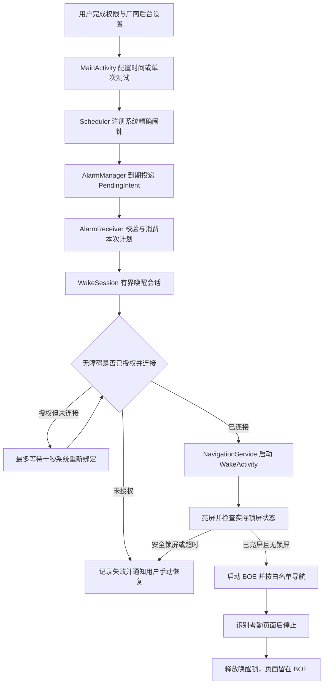

# 永不迟到：后台唤醒与无障碍可靠性实现机制

本文对应 v0.4.4，说明“助手首页没有打开、手机已经息屏时，为什么还能尝试打开考勤页”，
以及“为什么一加划掉任务后曾经需要重新授权、现在怎样处理”。

本文保留 v0.4.4 仅导航版本的实现与验收范围。v0.5.0 新增的确认计划或手动操作后的真实定位打卡、
独立预检、防重复和记录核验，见[当前考勤辅助说明](android-helper.md#真实打卡模式v050)；
下面的“不提交”描述不应被理解为新版本所有运行模式都不提交。

**我的打卡时间我做主。** 当前实现仍是页面导航测试，不是自动提交考勤。
到达页面不等于提交成功，后台保护也不等于永久保活。

安装配置见[真机使用说明](android-helper.md)，构建、签名和发布见[交付说明](RELEASE.md)。

## 1. 先区分五个不同概念

| 概念 | 含义 | 对本应用的影响 |
| --- | --- | --- |
| 首页不在前台 | 返回桌面、切换其他应用 | 不要求首页一直打开；闹钟和无障碍绑定不是由首页循环维持 |
| 最近任务卡片被移除 | 用户划掉卡片，或助手执行 `finishAndRemoveTask()` | 不是 Android 概念上的“必然强行停止”；但厂商可能附加清理行为 |
| 应用进程不存在 | 内存回收、异常退出等使本次进程结束 | 内存变量消失；后续恢复取决于系统调度、服务绑定及限制，不能直接等同于撤销授权 |
| 无障碍已授权但未连接 | 系统仍保存启用配置，但服务暂时没有绑定 | 可以短时间等待系统重连；不能直接提示用户“从未授权” |
| 系统强行停止 | 用户在应用详情操作，或系统执行对应的强停动作 | 不能依赖闹钟、广播或服务自行恢复；本机还会清掉无障碍启用配置 |

因此，“没有启动 App”需要具体区分：

- **没有打开助手首页**：当前设计和真机实测支持这种使用方式。
- **尚未完成首次配置**：不能自行授权或自行开启每日计划。
- **被强行停止、用户撤销授权或设备关机**：不在可靠自动运行的保证范围。

## 2. 总体架构



图中的等待有截止时间，不是无限循环。首页只负责配置和展示，不承担持续运行的定时器。
发生失败时记录本机日志并发送状态通知，不伪装成导航成功。

## 3. 定时为什么不依赖首页存活

### 3.1 使用系统闹钟，不在 Activity 中睡眠等待

[Scheduler](../app/src/main/java/com/luskyle/clockintest/Scheduler.kt) 使用：

```kotlin
alarms.setExactAndAllowWhileIdle(
    AlarmManager.RTC_WAKEUP,
    time,
    pendingIntent
)
```

- `RTC_WAKEUP` 使用绝对时间，可以在设备休眠时请求唤醒以投递闹钟。
- `setExactAndAllowWhileIdle` 允许在低功耗空闲状态下请求执行，但仍受系统配额和厂商限制。
- `PendingIntent.getBroadcast` 指向本应用的 `AlarmReceiver`，由系统负责投递。
- 不使用首页中的 `Handler` 或线程等到下班；首页销毁并不直接取消系统已注册的闹钟。
- CPU 能接收闹钟不等于屏幕已经点亮，点亮屏幕由后续独立步骤完成。

这条机制适用于系统允许的后台运行，不是绕过“强行停止”的通道。
“精确”也不代表任何电量、休眠和厂商策略下都能绝对准点。

### 3.2 双时段、工作日和持久化

[Store](../app/src/main/java/com/luskyle/clockintest/Store.kt) 在应用私有
`SharedPreferences` 中保存每个时段的：

| 字段 | 用途 |
| --- | --- |
| `MORNING/EVENING.enabled` | 是否由用户启用该计划 |
| `MORNING/EVENING.start`、`.end` | 用户选定的分钟范围 |
| `MORNING/EVENING.next` | 已选定并注册的下一次绝对触发时间 |
| `MORNING/EVENING.attempted` | 该时段最近一次自动尝试的北京时间日期 |
| `wakeTestAt` | 独立两分钟测试的触发时间；不属于每日时段 |
| `history` | 最多 80 条本机状态记录 |

上下班使用不同的闹钟请求码，互不覆盖。计划关键状态使用同步 `commit()`，
写入失败会明确报错，不只保留在进程内存中。

[TestPolicy](../app/src/main/java/com/luskyle/clockintest/TestPolicy.kt) 固定按
`Asia/Shanghai` 解释日期和时间窗口，在包含两端的整秒候选中随机一次。
例如 `17:30:00–17:32:00` 一共有 121 个候选整秒，不是在每次服务重连时重新抽取。

[ChinaWorkdays](../app/src/main/java/com/luskyle/clockintest/ChinaWorkdays.kt)
结合官方放假、调休补班和普通周末规则选取工作日。当前仅内置 2026 年，
不联网更新；缺失年份时暂停对应自动计划并提示更新，不把未知年份当成普通工作日。

### 3.3 先记“已尝试”，再执行导航

每日闹钟到期后依次：

1. 检查用户仍启用该时段、当前时间已到、计划日期与窗口有效。
2. 检查当天是工作日、没有超过窗口、该时段当天尚未尝试。
3. 符合条件时，**先持久化当天已尝试标记**。
4. 清除旧的下一次时间，并尝试安排后续工作日的计划。
5. 再检查运行条件并发起本次唤醒。

因此，即使导航中途失败，也不会在同一时段反复自动尝试。
这是避免重复操作的取舍，不是“失败后无限重试直到成功”。
上下班各自计数；停止、修改时间或者重新启用，不应清除当天防重复标记。

### 3.4 系统事件后的计划恢复

[Manifest](../app/src/main/AndroidManifest.xml) 注册的 `RestoreReceiver`
处理开机完成、同包覆盖更新、校时、时区变化和精确闹钟授权变化事件。

恢复逻辑重新检查保存的开关、时间窗口和工作日：

- 有效的未来触发时间优先保留。
- 已到时间但仍处于当天窗口且未尝试时，可以重新安排窗口内的触发。
- 超出窗口、当天已尝试或非工作日时，不补执行旧任务。
- 精确闹钟权限或日历数据缺失时，关闭失效计划并提示处理。

这只是对**系统实际投递的事件**作出响应，不保证强停后仍能收到广播。
本应用未实现解锁前的 Direct Boot 调度。
单次 `wakeTestAt` 测试不在每日 `restore()` 的重新注册逻辑中，
不能据此承诺它在重启、更新等事件后自动恢复。

## 4. 无障碍“授权”和“连接”是两层状态

### 4.1 授权保存在系统，不保存在静态变量

[NavigationAccess](../app/src/main/java/com/luskyle/clockintest/NavigationAccess.kt)
只读系统的 `Settings.Secure.ENABLED_ACCESSIBILITY_SERVICES`，
将其中各个组件名解析为 `ComponentName`，检查是否包含本应用的
`com.luskyle.clockintest.NavigationService`。

它不只是判断“系统开启过任意无障碍服务”，也不依靠字符串包含关系模糊匹配。
应用不写入这项设置、不使用 adb 静默授权，也不申请能改写它的系统权限。

### 4.2 连接是本次进程中的运行状态

[NavigationService](../app/src/main/java/com/luskyle/clockintest/NavigationService.kt)
继承 `AccessibilityService`：

- 用户正常授权后，由 Android 无障碍框架负责绑定服务。
- `onServiceConnected()` 将当前服务写入 `NavigationService.instance`，并记录连接日志。
- `onDestroy()` 清除该引用；正在执行时停止导航。
- `onInterrupt()` 停止当前测试，不继续点击。
- 服务连接本身**不会发起导航**，仍需用户立即测试或有效闹钟请求。

`instance` 只是“当前进程中有一个已连接的服务实例”的信号，
不是永久授权凭据。普通进程退出后该内存状态会消失，不足以证明授权被撤销。
代码不直接 `startService()` 冒充系统绑定，也没有无限重绑或静默重新授权机制。

### 4.3 v0.4.4 的三态判断

| 系统列表包含自身服务 | 当前实例存在 | 展示及处理 |
| --- | --- | --- |
| 否 | 否 | 未授权或已被系统关闭，提示手动恢复 |
| 否 | 是 | 仍按未授权处理，残留引用不能覆盖撤销授权的事实 |
| 是 | 否 | 已授权，暂未连接；提示等待、检查后台保护，必要时手动重开 |
| 是 | 是 | 已连接，可以继续检查其他运行条件 |

原先只看 `instance == null`，容易把“授权仍在、连接暂断”误报成“未开启”。
本次修正同时用于运行设置、立即测试、调度条件及唤醒等待过程，
不是只改一个界面的显示文字。

连接状态是瞬时状态，显示已连接不等于未来不会中断。
执行过程中仍需再次检查并受超时保护。

### 4.4 定时与用户立即操作的检查方式不同

- 用户开启计划、安排单次测试时，要求当前已经连接，避免明知不可运行还安排测试。
- 闹钟到期时，`requirements(false)` 允许“已授权但暂未连接”进入唤醒等待。
- 如果系统启用列表已经没有自身服务，即使是闹钟触发也会明确报错，不假装可以自行授权。
- “立即测试”直接调用当前服务；没有连接时明确提示，不通过隐藏方式启动服务。

通知、精确闹钟和 BOE 安装状态仍是调度条件的一部分。
厂商后台开关没有被当成一个已经自动配置成功的布尔值，必须由用户实际检查。

## 5. 息屏时怎样唤醒

### 5.1 WakeSession：短时会话，而不是常驻保活

[WakeSession](../app/src/main/java/com/luskyle/clockintest/WakeSession.kt) 负责：

1. 拒绝已有唤醒或导航会话期间的重复请求。
2. 检查本次截止时间，过期请求不启动。
3. 获取带超时的 `PARTIAL_WAKE_LOCK`，让 CPU 在短时处理期间有机会继续运行。
4. 每 500 毫秒检查一次服务连接，最多等待十秒。
5. 连接成功后，调用服务的 `wakeScreen()` 打开专用亮屏 Activity。
6. 完成、失败或停止时释放锁、清理超时，并使旧的延迟回调失效。

部分唤醒锁**本身不负责点亮屏幕**。锁的最长时长为
`min(65 秒, 本次截止时间 - 当前时间)`，不是一直持有。

会话同时记录绝对截止时间和 `elapsedRealtime()` 截止时间，
避免只依靠可调整的墙上时钟延长会话。内部 generation 标记用于让旧请求的回调失效，
不是跨进程的任务队列。

### 5.2 为什么由无障碍服务打开专用页面

`NavigationService.wakeScreen()` 发起 `WakeActivity`，利用系统允许的
无障碍服务后台启动能力尝试显示页面；仍可能被厂商限制或系统拒绝。
异常会被捕获并报告，静默拦截也会由有界超时结束。

[WakeActivity](../app/src/main/java/com/luskyle/clockintest/WakeActivity.kt)
不是助手首页：

- `exported=false`，不作为外部应用随意触发的入口。
- 独立任务 affinity，且排除在最近任务列表之外。
- 运行时及 Manifest 使用 `setShowWhenLocked` / `setTurnScreenOn` 对应配置。
- 发起 BOE 导航后立即 `finish()`，不在结束时把助手首页拉回前台。
- 只接收有效唤醒会话；普通过期启动直接退出。

因此，用户不需要先看到助手首页，再由首页跳转 BOE。

### 5.3 普通锁屏与安全锁屏

| 手机状态 | 当前处理 |
| --- | --- |
| 已亮屏、已解锁 | 直接进入导航步骤 |
| 息屏、没有安全认证要求 | 尝试亮屏，必要时请求系统解除普通锁屏 |
| 正在锁屏且配置安全认证 | 停止并提醒手动解锁，不绕过密码、人脸或指纹 |
| 导航途中再次锁屏 | 立即停止本次导航 |

普通锁屏使用 `requestDismissKeyguard()`。一加实测中，
其成功回调可能早于实际锁屏状态更新，因此不能仅凭回调就启动 BOE。

代码继续每 100 毫秒确认：

```text
PowerManager.isInteractive == true
并且 KeyguardManager.isKeyguardLocked == false
```

亮屏与解除普通锁屏流程最多等待八秒。取消、错误、超时或会话失效都会停止。
安全锁屏场景不会在用户后来解锁时自动续跑，需手动点击立即测试。

### 5.4 为什么先检查“锁屏显示权限”

部分厂商还会额外询问“在锁屏上显示”的权限。
若首次询问发生在息屏期间，用户看不到弹窗，自动亮屏流程就可能被挡住。

运行设置的预检入口以 `preview=true` 打开同一个 Activity：

- 在用户亮屏操作时提前展示厂商授权询问。
- 仅展示说明，不启动唤醒会话、不打开 BOE，也不证明后台测试已经成功。
- 授权后仍需实际息屏测试。

应用不更改手机安全锁配置，不使用设备管理员、Device Owner 或 root 绕过限制。

## 6. BOE 页面导航为什么不会提交

服务只针对 `com.mobile.boe` 的活动窗口操作，遍历最多 1500 个无障碍节点。
导航开始后延迟一秒首次检查，随后每 500 毫秒检查一次。

### 6.1 只有两个可点击的目标

| 控件 ID | 文本约束 |
| --- | --- |
| `com.mobile.boe:id/tab_apps` | 空文本或严格为“工作台” |
| `com.mobile.boe:id/name_tv` | 严格为“考勤打卡” |

匹配入口必须对用户可见；入口不唯一时直接停止。
实际点击前再次检查白名单，并只允许目标本身或其最多三层父容器，
且容器须属于 BOE、可见、启用、可点击。

若当前是 BOE 小程序且尚未找到入口，允许一次系统返回以尝试回到工作台。
没有点击坐标、任意手势或点击“看起来像提交按钮”的降级路径。

### 6.2 成功、需确认与失败不混为一谈

- 节点文本出现“蓝牙打卡”“定位打卡”或“打卡记录”中的任一项，
  即记录“已到达打卡页面”，停止，**不点击这些标记**。
- 已点击考勤入口，但小程序内容不可读，等待至少五秒后记录“需人工确认页面”，
  不记录成已验证成功。
- 发现登录提示、登录/锁定页面、系统权限弹窗、点击失败、锁屏或超时，明确停止。
- BOE 版本、节点暴露方式或文案变化可能使识别失效，需要重新验收；
  这些标记不能证明实际提交了考勤，不用于校验实际考勤结果，也不保存页面内容或考勤记录。

导航最长 45 秒，同时不能超过本次绝对截止时间；另有单调时钟的 45 秒限制。
停止会取消后续检查、释放唤醒会话，并发出本机状态通知。

## 7. 一加为什么曾经划掉任务就丢授权

### 7.1 复现到的不是“界面显示不准”

在一加 Android 13 上，未配置后台保护时：

1. 普通返回桌面并重开三轮，授权和绑定都在。
2. 真正手动划掉本应用的最近任务卡片后，系统日志出现清理器的
   `stop com.luskyle.clockintest`、`with swipe up` 终止记录。
3. `dumpsys accessibility` 的已启用服务和绑定服务列表同时变空，
   而不是只有连接暂时断开；崩溃列表为空。

所以本轮实际有两个问题：

- **诊断问题**：原来的代码把断线和未授权混为一谈，需要三态判断。
- **系统策略问题**：该机的后台清理会真正关闭服务，仅改文字不能解决。

### 7.2 本次采用的正常系统配置

在本应用“应用详情 → 耗电管理”中：

| 配置 | 本次最终状态 |
| --- | --- |
| 允许唤醒前台 | 开启 |
| 允许完全后台行为 | 开启 |
| 允许应用自启动 | 开启 |
| 允许应用关联启动 | 关闭 |

本轮将“完全后台行为”和“自启动”**一起开启**后复测通过，
没有分别关闭其中一项做独立 A/B，因此不声称某一项单独就足够。

这些是厂商设置，不等同于本应用调用了某个标准 Android“永久保活”API。
允许完全后台行为可能增加耗电；普通电池优化入口也不能代替所有厂商开关。
其他品牌或系统版本需要按实际设置检查，不能直接外推本次一加结果。

### 7.3 App 中新增的入口做了什么

[MainActivity](../app/src/main/java/com/luskyle/clockintest/MainActivity.kt)
的“自启动与后台保护（重要）”：

1. 展示一加 / OPPO 系统中的配置路径及限制说明。
2. 使用 `ACTION_APPLICATION_DETAILS_SETTINGS` 和本应用包名打开自身应用详情。
3. 由用户在系统界面完成开关配置。

它没有偷偷打开这些开关，没有请求无关的关联启动授权，
也没有用厂商私有组件名硬编码跳转并宣称已经设置成功。
无障碍已经被关掉时，仍须在正常系统设置中手动授权一次。

### 7.4 为什么不能承诺“一次授权，终身有效”

本机进一步对照确认：即使配置了后台保护，显式“强行停止”仍会清空无障碍授权。
随后正常打开应用、同签名覆盖升级也不会自行恢复。

用户主动撤权、系统安全策略、应用卸载、签名变化、系统升级等，也可能影响授权或运行。
授权的最终控制权属于用户和操作系统，不属于 App。

本项目没有常驻前台服务、无限循环拉活、定期自杀重启、静默授权、
安全锁绕过或 Device Owner 接管。这不是遗漏一个“永久授权按钮”，而是明确的权限边界。

## 8. 独立两分钟测试怎样避免影响日常计划

“运行设置 → 2 分钟后息屏测试（仅一次）”：

1. 检查当前运行条件。
2. 保存 `wakeTestAt = 当前时间 + 120 秒`，注册独立请求码的精确闹钟。
3. 确认后执行 `finishAndRemoveTask()`，关闭首页并移除其任务卡片。
4. 用户自行熄屏，等待闹钟自然触发。
5. 接收时先清除 `wakeTestAt`，防止重复消费；提前送达则不消费。
6. 若已比预定时间晚超过一分钟，记录过期并跳过。
7. 未过期则以“预定时间 + 一分钟”为截止时间启动唤醒会话。

它不修改上下班窗口、开关、下一次随机时间或已尝试日期；
重复安排替换同一个单次闹钟，不新增多个并行测试。
停止测试会同时取消两项每日计划、单次闹钟和当前唤醒会话。

`finishAndRemoveTask()` 与厂商对用户划卡附加的清理、系统强行停止不是同一个动作，
因此需要分别验证，不能拿其中一种成功代替所有“退出 App”场景。

## 9. 超时与失败处理汇总

| 环节 | 约束 | 失败处理 |
| --- | --- | --- |
| 单次测试迟到 | 超过预定时间一分钟跳过 | 消费旧测试、通知，不补执行 |
| 无障碍重新绑定 | 最多十秒，每 500 毫秒检查 | 明确提示后台/服务设置，结束会话 |
| 亮屏及普通解锁 | 最多八秒；状态检查间隔 100 毫秒 | 停止并提示手动处理 |
| BOE 导航 | 最多 45 秒且不超过本次截止时间 | 停止，不提交，不无限重试 |
| CPU 唤醒锁 | 最多 65 秒且不超过剩余会话时间 | 主动释放，并有系统超时兜底 |
| 未知年份 | 不猜测工作日 | 暂停对应计划并提示更新 |
| 关键持久化失败 | 同步写入并检查结果 | 明确报错，不默认为写入成功 |

上述时间不是依次相加的固定等待：它们共享本次截止时间，
前一步延迟会减少后续可用时间。成功也会立即清理，不等所有超时耗尽。

## 10. 已完成验证与未覆盖范围

### 10.1 2026-10-29 实测

| 场景 | 次数 / 条件 | 结果 |
| --- | --- | --- |
| 原始设置下 HOME 返回桌面并重开 | 三轮 | 授权和连接保留 |
| 原始设置下真实划掉本应用卡片 | 一轮 | 授权及绑定被系统清除，复现问题 |
| 开启完全后台行为、自启动后划卡 | 原版本三轮 | 授权和连接保留 |
| 同签名更新 v0.4.4 后再次划卡 | 三轮 | 授权和连接保留 |
| 后台保护开启后显式强行停止 | 一轮 | 授权被清除；正常重开及更新不能自动恢复 |
| 新版未授权 / 已连接提示 | 真实系统状态 | 界面分别正确显示 |
| 后台保护入口 | 新版实际操作 | 打开自身应用详情，配置在覆盖升级后保留 |
| 新版退出助手、确认息屏后自然闹钟 | 一次独立两分钟测试 | `16:59:39` 触发亮屏，`16:59:42` 到达考勤页 |

最后一项在触发时没有使用 adb 点亮屏幕或启动 BOE。
事后只读确认考勤小程序前台及四项页面标志，未点击任何提交按钮；
每日计划仍关闭、单次测试已消费、已有当天防重复标记保留。

31 项 JVM 单元测试、lint、debug/release APK 与设备测试 APK 编译通过。
[NavigationAccessTest](../app/src/test/java/com/luskyle/clockintest/NavigationAccessTest.kt)
新增四项状态组合测试。本轮未运行会影响生产无障碍连接的仪器测试。

### 10.2 不能从上述结果推导出的保证

- 没有单独完成普通进程异常终止后的恢复验证。
- 未完成长期深度休眠、重启恢复、断网、低电量和跨系统升级的连续多天验收。
- 无法保证安全锁屏自动解锁、强停后自动复活或永久保留授权。
- 未验证所有手机品牌、BOE 版本及小程序节点变化。
- 未实现年度工作日日历自动下载。
- **没有实现、也没有测试自动提交考勤。**

## 11. 排查顺序与只读诊断

优先在本机按以下顺序排查：

1. 看运行设置中的无障碍三态，不把“暂未连接”直接等同于撤权。
2. 看执行记录：是否收到定时请求、是否成功亮屏、是否识别页面、具体停在哪一步。
3. 若已被系统关闭，手动恢复授权，再检查厂商完全后台行为、自启动设置。
4. 若授权仍在但持续未连接，等待片刻；仍失败时按提示在系统设置重开服务。
5. 检查通知、精确闹钟、锁屏显示授权及 BOE 登录状态。
6. 用独立两分钟测试复验，不通过修改日常时间或清除已尝试日期反复制造执行。

开发者可以使用与项目一致的 SDK adb，**明确指定目标设备**，只读检查：

```bash
# 先按本机环境设置 ADB 路径和 SERIAL，勿默认操作其他设备。
"$ADB" -s "$SERIAL" shell dumpsys accessibility \
  | grep -E 'Bound services:|Enabled services:|Crashed services:'

"$ADB" -s "$SERIAL" shell dumpsys power | grep mWakefulness

"$ADB" -s "$SERIAL" logcat -d -s ClockInTest:I
```

诊断关注自身服务，不提交其他应用信息、个人页面、账号、设备地址或运行数据。
不要用 `settings put`、卸载、清数据或强行停止来“修复”生产授权。
仪器测试及 UI 自动化也可能暂时影响无障碍连接，不能把它们的副作用误认为普通退出行为；
相关约束见[重跑仪器测试](android-helper.md#重跑仪器测试)。

## 12. 源码索引

| 文件 | 职责 |
| --- | --- |
| [MainActivity.kt](../app/src/main/java/com/luskyle/clockintest/MainActivity.kt) | 用户配置、状态展示、厂商保护指引、安排并退出 |
| [NavigationAccess.kt](../app/src/main/java/com/luskyle/clockintest/NavigationAccess.kt) | 只读系统授权配置与本次连接状态，形成三态 |
| [Scheduler.kt](../app/src/main/java/com/luskyle/clockintest/Scheduler.kt) | 精确闹钟、接收器、恢复、消费及每日防重复 |
| [Store.kt](../app/src/main/java/com/luskyle/clockintest/Store.kt) | 私有持久化、本机日志及通知 |
| [TestPolicy.kt](../app/src/main/java/com/luskyle/clockintest/TestPolicy.kt) | 北京时间、候选整秒、窗口和点击白名单 |
| [ChinaWorkdays.kt](../app/src/main/java/com/luskyle/clockintest/ChinaWorkdays.kt) | 内置工作日日历与缺失年份暂停 |
| [WakeSession.kt](../app/src/main/java/com/luskyle/clockintest/WakeSession.kt) | 有界 CPU 唤醒、等待服务、截止时间及清理 |
| [WakeActivity.kt](../app/src/main/java/com/luskyle/clockintest/WakeActivity.kt) | 亮屏、锁屏检查、普通解锁状态确认、预检 |
| [NavigationService.kt](../app/src/main/java/com/luskyle/clockintest/NavigationService.kt) | 系统绑定、BOE 启动、白名单导航和停止条件 |
| [AndroidManifest.xml](../app/src/main/AndroidManifest.xml) | 权限、内部组件、服务绑定保护及恢复事件 |
| [navigation_service.xml](../app/src/main/res/xml/navigation_service.xml) | 无障碍事件、节点读取与 view ID 配置 |
